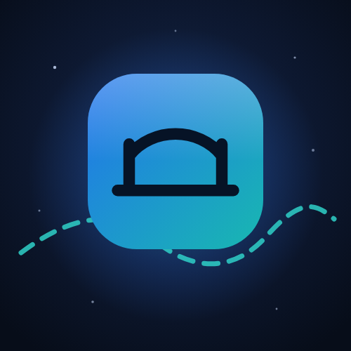
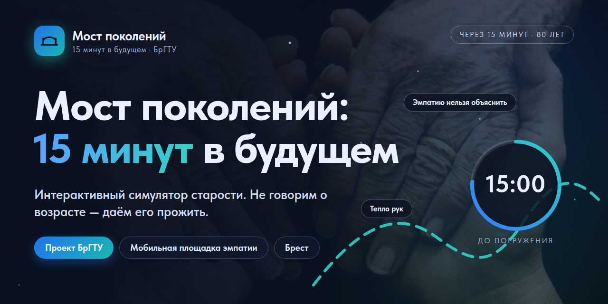

# Мост поколений: 15 минут в будущем

Website of a student social project of Brest State Technical University (BrSTU): an interactive old-age simulator that lets young people live 15 minutes "in the future" and see everyday life through the eyes of their parents and grandparents.

Live site: https://grandhelp-by.github.io/

